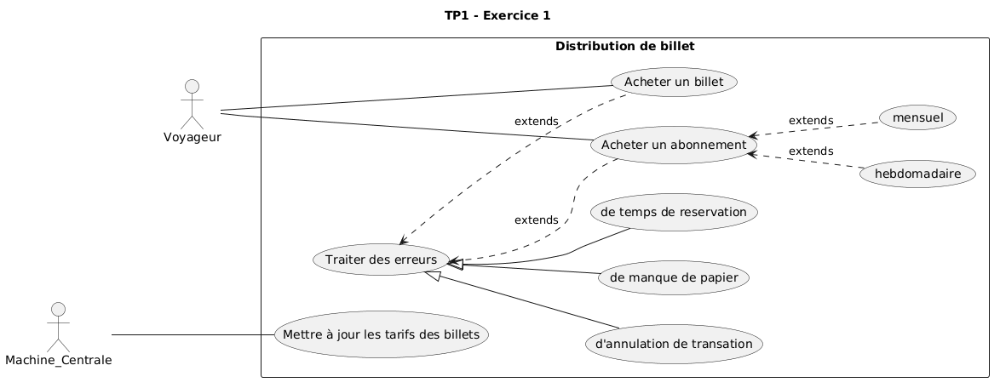
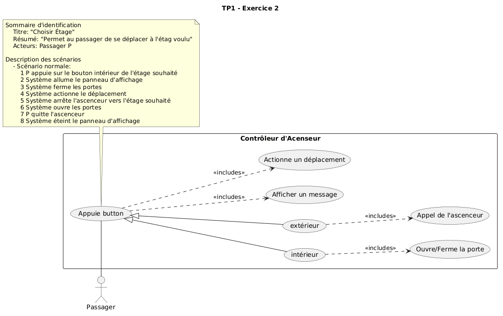
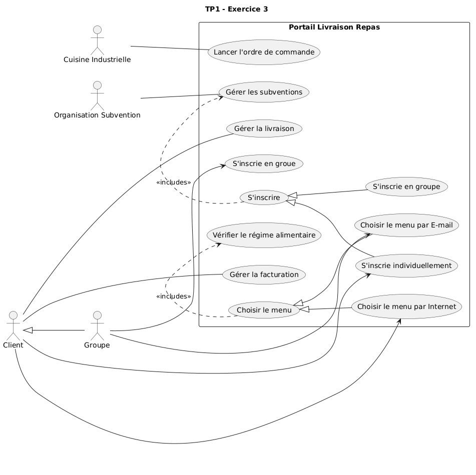
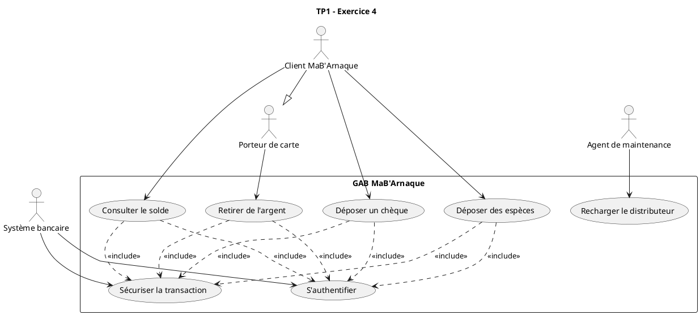
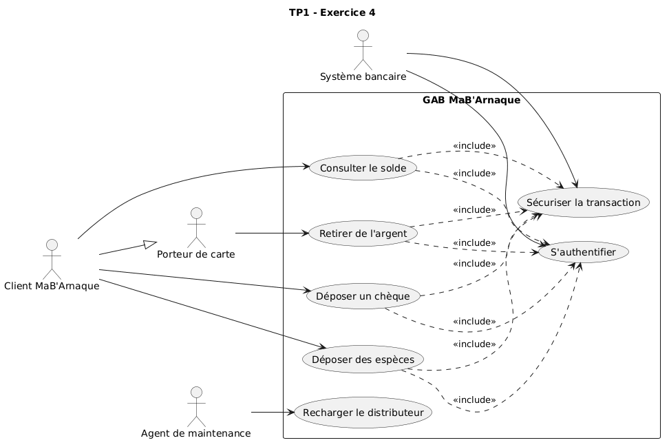

# TP 1 : Diagrammes de Cas d’Utilisation UML

## Exercice 1 
```uml
@startuml

actor "Voyageur"
actor "Machine_Centrale"

rectangle "Distribution de billet"{
Voyageur --- (Acheter un billet)
Voyageur --- (Acheter un abonnement)
(Acheter un abonnement) <.- (hebdomadaire) : extends
(Acheter un abonnement) <.- (mensuel) : extends
Machine_Centrale --- (Mettre à jour les tarifs des billets)
(Traiter des erreurs) <|-- (de temps de reservation)
(Traiter des erreurs) <|-- (d'annulation de transation)
(Traiter des erreurs) <|-- (de manque de papier)
(Traiter des erreurs) <.- (Acheter un billet) : extends
(Traiter des erreurs) <.- (Acheter un abonnement) : extends
}

@enduml
```


## Exercice 2
### 1. Diagramme de Cas d'Utilisation
```uml
@startuml

actor "Passager"

rectangle "Contrôleur d'Acenseur"{
Passager -> (Appuie button)
(Appuie button) <|-- (intérieur)
(Appuie button) <|-- (extérieur)
(Appuie button) -.> (Afficher un message) : <<includes>>
(Appuie button) -.> (Actionne un déplacement) : <<includes>>
(intérieur) -.> (Ouvre/Ferme la porte) : <<includes>>
(extérieur) -.> (Appel de l'ascenceur) : <<includes>>
}

@enduml
```

### 2. Scenario :
```text
Sommaire d'identification
    Titre: "Choisir Étage"
    Résumé: "Permet au passager de se déplacer à l'étag voulu"
    Acteurs: Passager P

Description des scénarios
    - Scénario normale:
        1 P appuie sur le bouton intérieur de l'étage souhaité
        2 Système allume le panneau d'affichage
        3 Système ferme les portes
        4 Système actionne le déplacement
        5 Système arrête l'ascenceur vers l'étage souhaité
        6 Système ouvre les portes
        7 P quitte l'ascenceur
        8 Système éteint le panneau d'affichage
```


## Exercice 3
### 1. Identification des acteurs  
- **Acteurs principaux :**
    - Client individuel (utilisateur physique effectuant une inscription directe).  
    - Groupe (représentant d'une structure comme une maison de retraite).  
- **Acteurs secondaires / Systèmes externes :**
    - Organisme de subvention (Sécurité sociale, groupe d'assurance, etc.).  
    - Cuisine industrielle (sous-traitant préparant les repas). 

### 2. Diagramme de Cas d'Utilisation
``` uml
@startuml
title TP1 - Exercice 3

actor "Client"
actor "Groupe"
actor "Cuisine Industrielle" as CI
actor "Organisation Subvention" as OS

Client <|-- Groupe

rectangle "Portail Livraison Repas" {
  Client --> (S'inscrie individuellement)
  Client --> (Choisir le menu par Internet)
  Client -- (Gérer la livraison)
  Client -- (Gérer la facturation)
  
  Groupe --> (S'inscrie en groue)
  Groupe --> (Choisir le menu par E-mail)
  
  OS -- (Gérer les subventions)
  CI -- (Lancer l'ordre de commande)
  
  (S'inscrire) <|-- (S'inscrie individuellement)
  (S'inscrire) <|-- (S'inscrie en groupe)
  (S'inscrire) .> (Gérer les subventions) : <<includes>>
  (Choisir le menu) <|-- (Choisir le menu par Internet)
  (Choisir le menu) <|-- (Choisir le menu par E-mail)
  (Choisir le menu) .> (Vérifier le régime alimentaire) : <<includes>>
}
@enduml
```


## Exercice 4
### 1/3. Identification des acteurs
- **Acteurs principaux :** 
    - Porteur de carte bancaire(Toute personne possédant une carte bancaire, cliente ou non de MaB'Arnaque).
    - Client MaB'Arnaque(Porteur d'une carte bancaire délivrée par MaB'Arnaque, qui peut consulter son solde et effectuer des dépôts).

- **Acteurs secondaires :**
    - Agent de maintenance (chargée de recharger le distributeur de billets).
    - Système bancaire ( vérifie les cartes, authentifie les utilisateurs et traite les transactions).

### 2. Identification des cas d'utilisation


| N°  | Cas d'utilisation           | Description                                                            |
| --- | --------------------------- | ---------------------------------------------------------------------- |
| CU1 | Retirer de l'argent         | Permet à un porteur de carte de retirer des billets.                   |
| CU2 | Consulter le solde          | Permet à un client MaB'Arnaque de consulter le solde de son compte.    |
| CU3 | Déposer de l'argent liquide | Permet à un client de déposer des espèces.                             |
| CU4 | Déposer un chèque           | Permet à un client de déposer un chèque.                               |
| CU5 | S'authentifier              | Vérifie l'identité du porteur de carte grâce à son code confidentiel.  |
| CU6 | Sécuriser la transaction    | Garantit la sécurité des opérations bancaires.                         |
| CU7 | Recharger le distributeur   | Permet à l'agent de maintenance de remplir le distributeur de billets. |

### 4. Diagramme de cas d'utilisation UML




### 5. Scénarios et descriptions des cas d'utilisation

### CU1 – Retirer de l'argent

Acteur principal : Porteur de carte.

Acteur secondaire : Système bancaire.

Préconditions :

- Le GAB est opérationnel.
    
- Le porteur possède une carte bancaire valide.
    

Scénario nominal :

1. Le porteur insère sa carte bancaire.
    
2. Le GAB lit les informations de la carte.
    
3. Le GAB demande le code confidentiel.
    
4. Le porteur saisit son code PIN.
    
5. Le système bancaire vérifie le code.
    
6. Le GAB demande le montant à retirer.
    
7. Le porteur saisit le montant.
    
8. Le système bancaire vérifie et autorise la transaction.
    
9. Le GAB distribue les billets.
    
10. Le GAB restitue la carte.
    
11. La transaction est terminée.
    

Scénarios alternatifs :

- A1 : Carte invalide ou expirée → le GAB refuse la transaction.
    
- A2 : Code PIN incorrect → le GAB demande une nouvelle saisie.
    
- A3 : Trois codes incorrects → la carte est bloquée ou retenue selon les règles bancaires.
    
- A4 : Solde insuffisant → le retrait est refusé.
    
- A5 : Distributeur vide → le retrait est impossible.
    
- A6 : Montant supérieur au plafond autorisé → le retrait est refusé.
    
- A7 : Problème de communication avec la banque → la transaction est interrompue.
    

Postcondition : Les billets sont distribués et le compte est débité si la transaction est acceptée.

### CU2 – Consulter le solde

Acteur principal : Client MaB'Arnaque.

Acteur secondaire : Système bancaire.

Préconditions :

- Le client possède une carte MaB'Arnaque valide.
    
- Le GAB est opérationnel.
    

Scénario nominal :

1. Le client insère sa carte.
    
2. Le GAB lit les informations.
    
3. Le GAB demande le code PIN.
    
4. Le client saisit son code.
    
5. Le système bancaire vérifie l'identité.
    
6. Le client sélectionne « Consultation du solde ».
    
7. Le GAB demande le solde au système bancaire.
    
8. Le système bancaire transmet le solde.
    
9. Le GAB affiche le solde.
    
10. Le GAB restitue la carte.
    

Scénarios alternatifs :

- A1 : Carte invalide → consultation refusée.
    
- A2 : Code PIN incorrect → nouvelle saisie demandée.
    
- A3 : Client non reconnu comme client MaB'Arnaque → service refusé.
    
- A4 : Serveur bancaire indisponible → consultation impossible.
    

Postcondition : Le solde est affiché sans modification du compte.

### CU3 – Déposer des espèces

Acteur principal : Client MaB'Arnaque.

Acteur secondaire : Système bancaire.

Préconditions :

- Le client possède une carte MaB'Arnaque valide.
    
- Le GAB dispose d'un module de dépôt d'espèces.
    

Scénario nominal :

1. Le client insère sa carte.
    
2. Le GAB lit la carte.
    
3. Le client saisit son code PIN.
    
4. Le système bancaire authentifie le client.
    
5. Le client sélectionne « Déposer des espèces ».
    
6. Le GAB demande le montant du dépôt.
    
7. Le client insère les billets.
    
8. Le GAB vérifie et compte les billets.
    
9. Le GAB affiche le montant détecté.
    
10. Le client confirme le dépôt.
    
11. Le GAB transmet l'opération au système bancaire.
    
12. Le système bancaire enregistre le dépôt.
    
13. Le GAB restitue la carte et délivre un reçu.
    

Scénarios alternatifs :

- A1 : Carte invalide → dépôt refusé.
    
- A2 : Code PIN incorrect → opération interrompue.
    
- A3 : Billets non conformes ou endommagés → billets rejetés.
    
- A4 : Montant incorrect → le client peut recommencer.
    
- A5 : Client annule l'opération → dépôt annulé.
    
- A6 : Panne du système bancaire → dépôt suspendu ou annulé selon l'état de traitement.
    

Postcondition : Le dépôt est enregistré sur le compte du client.

### CU4 – Déposer un chèque

Acteur principal : Client MaB'Arnaque.

Acteur secondaire : Système bancaire.

Préconditions :

- Le client possède une carte MaB'Arnaque valide.
    
- Le GAB dispose d'un module de réception de chèques.
    

Scénario nominal :

1. Le client insère sa carte.
    
2. Le GAB lit la carte.
    
3. Le client saisit son code PIN.
    
4. Le système bancaire authentifie le client.
    
5. Le client sélectionne « Déposer un chèque ».
    
6. Le GAB demande d'insérer le chèque.
    
7. Le client insère le chèque.
    
8. Le GAB réceptionne le chèque.
    
9. Le client confirme le dépôt.
    
10. Le GAB transmet les informations au système bancaire.
    
11. Le système bancaire enregistre le dépôt.
    
12. Le GAB restitue la carte et délivre un reçu.
    

Scénarios alternatifs :

- A1 : Carte invalide → opération refusée.
    
- A2 : Code PIN incorrect → opération interrompue.
    
- A3 : Chèque illisible ou non conforme → chèque rejeté.
    
- A4 : Client annule l'opération → dépôt annulé si le chèque peut être restitué.
    
- A5 : Problème de communication avec la banque → opération interrompue ou mise en attente.
    

Postcondition : Le dépôt du chèque est enregistré, éventuellement sous réserve d'encaissement.

### CU5 – S'authentifier

Acteur principal : Porteur de carte.

Acteur secondaire : Système bancaire.

Préconditions :

- Une carte bancaire est insérée dans le GAB.

Scénario nominal :

1. Le GAB lit la carte.
    
2. Le GAB demande le code PIN.
    
3. Le porteur saisit son code.
    
4. Le GAB transmet la demande de vérification au système bancaire.
    
5. Le système bancaire vérifie le code.
    
6. Le système bancaire confirme l'authentification.

7. Le GAB autorise l'accès aux services disponibles pour cette carte.
    

Scénarios alternatifs :

- A1 : Carte illisible → carte restituée.
    
- A2 : Code PIN incorrect → nouvelle tentative.
    
- A3 : Nombre maximal de tentatives atteint → carte bloquée ou retenue selon les règles.
    
- A4 : Carte expirée ou bloquée → authentification refusée.
    
- A5 : Système bancaire indisponible → authentification impossible.
    

Postcondition : Le porteur est authentifié ou l'accès est refusé.

### CU6 – Sécuriser une transaction

Acteur principal : GAB.

Acteur secondaire : Système bancaire.

Préconditions :

- Une transaction est demandée.
    
- Une carte bancaire est insérée.
    

Scénario nominal :

1. Le GAB identifie le type de carte.
    
2. Le GAB établit une communication sécurisée avec le système bancaire concerné.
    
3. Les informations sensibles sont protégées.
    
4. Le système bancaire vérifie et autorise la transaction.
    
5. Le GAB reçoit la réponse.
    
6. La transaction est exécutée de manière sécurisée.
    

Scénarios alternatifs :

- A1 : Communication non sécurisée → transaction refusée.
    
- A2 : Système bancaire indisponible → transaction interrompue.
    
- A3 : Authentification échouée → transaction refusée.
    
- A4 : Réponse invalide → opération interrompue.
    

Postcondition : La transaction est exécutée de manière sécurisée ou refusée.

### CU7 – Recharger le distributeur

Acteur principal : Agent de maintenance.

Préconditions :

- L'agent est autorisé à accéder au distributeur.
    
- Le distributeur nécessite un réapprovisionnement.
    

Scénario nominal :

1. L'agent ouvre le compartiment sécurisé du distributeur.
    
2. Il vérifie le niveau de billets disponibles.
    
3. Il introduit les nouvelles liasses de billets.
    
4. Il vérifie le chargement.
    
5. Il referme et verrouille le compartiment.
    
6. Le GAB met à jour le niveau de billets disponibles.
    
7. Le distributeur reprend son fonctionnement normal.
    

Scénarios alternatifs :

- A1 : Mauvais chargement → l'agent corrige le chargement.
    
- A2 : Quantité de billets incorrecte → nouveau comptage.
    
- A3 : Panne du distributeur → intervention technique nécessaire.
    
- A4 : Accès non autorisé → opération refusée.
    

Postcondition : Le distributeur contient suffisamment de billets pour effectuer les retraits.


